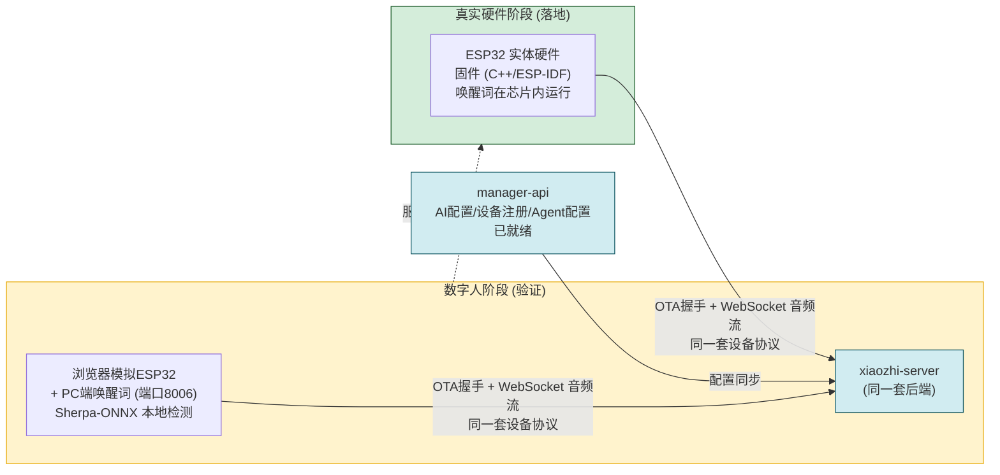

# 从数字人迁移到 ESP32 硬件 (Digital Human → ESP32 Migration)

> 结论:可以"毕业"而非"迁移"。服务器配置完全复用;客户端侧从浏览器页面换成真实固件。

## 交接关系图

## 什么可以复用 (零改动)

- AI 服务配置 (ASR / LLM / TTS / VAD)—— 智控台配置 → `manager-api` → `xiaozhi-server`
- 设备注册与绑定流程 (基于 MAC 地址)
- Agent / 角色配置、插件、MCP 工具 (服务端,与设备无关)
- 完整的语音链路已验证可用

## 什么需要重新做

| 方面 | 数字人 | 真实 ESP32 |
|------|--------|-----------|
| 客户端代码 | 浏览器页面 + Python | 固件 (C++ / ESP-IDF),需编译烧录 |
| 唤醒词 | PC 上 Sherpa-ONNX (8006) | 芯片内运行,编译进固件 (`CONFIG_USE_AFE_WAKE_WORD` / `CONFIG_USE_CUSTOM_WAKE_WORD`) |
| 音频采集 | 浏览器麦克风 (Opus) | 真实麦克风阵列 + AEC 硬件 |
| 数字人形象 (Live2D) | 浏览器渲染 | ESP32 无显示,需另配屏幕/一体机 |
| MCP 工具 | 浏览器 mock 工具 | 固件内真实工具 (如 `self.remote_wakeup`) |

## 切换步骤

1. **编译固件**:按 `docs/firmware-build.md`(ESP-IDF → `merged-binary.bin`)
2. **固件里配置唤醒词**(menuconfig,不是数字人的设置页)
3. **烧录设备**(USB 或 ESP-Launchpad Web 烧录)
4. **智控台注册真实设备**(真实 MAC)
5. **上电** — 设备自动走 OTA 握手 → WebSocket 连接,与数字人完全一致

## 备注

- `digital-human` 不需要删除,可长期保留作为快速测试/调试工具。
- 若要做"数字人一体机",可参考 `docs/all-in-one-digital-human-setup.md`(数字人 + 唤醒词服务部署在同一台带屏设备上)。
