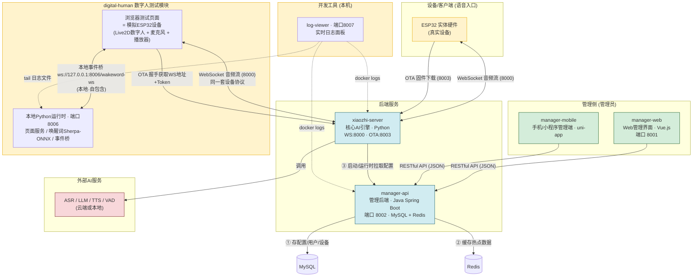

# 组件关系图 (Component Relationships)

> 基于 `main/README.md` 与 `main/digital-human/` 实际代码梳理。
> 关键点:`digital-human` 的浏览器页面其实是**模拟的 ESP32 设备**,与真实硬件走同一套 WebSocket 协议。

## 全景关系图

## 一句话总结

| 组件 | 角色 | 语言/技术 | 端口 | 服务对象 |
|------|------|-----------|------|----------|
| `xiaozhi-server` | 核心AI引擎(大脑) | Python + asyncio | 8000 (WS), 8003 (OTA) | ESP32 设备 / 数字人模拟设备 |
| `manager-api` | 管理后端(行政部) | Java + Spring Boot | 8002 | 管理界面 + 给大脑提供配置 |
| `manager-web` | Web 管理界面 | Vue.js | 8001 | 管理员(浏览器) |
| `manager-mobile` | 移动管理端 | uni-app + Vue3 | 无固定 | 管理员(手机/小程序) |
| `digital-human` | 数字人测试模块 | Python + HTML/JS | 8006 (本地) | 开发者(无硬件测试) |
| `log-viewer` | 实时日志面板(排障) | Python (stdlib) + HTML/JS | 8007 (本地) | 开发者(看整栈日志) |

## 两条主线

1. **语音主线 (实时)**:ESP32 设备 或 digital-human 模拟设备 ⇄ `xiaozhi-server` (WebSocket)
2. **管理主线 (非实时)**:管理员通过 `manager-web` / `manager-mobile` → `manager-api` → 保存到 MySQL → `xiaozhi-server` 拉取配置生效

## digital-human 的双重身份

| 部分 | 自包含? | 与后端交互? |
|------|---------|-------------|
| Python 运行时 (`start.py` + `wakeword_runtime/`,端口 8006) | ✅ 完全本地 | ❌ 不交互 |
| 浏览器测试页面 (`index.html` + `js/`) | ❌ 需要后端 | ✅ 直接连 `xiaozhi-server` |

- **与后端的连接**:页面扮演"假 ESP32",走 OTA 握手 → WebSocket 连 `xiaozhi-server`,实现完整语音链路。
- **对 manager-api**:仅间接 (通过 xiaozhi-server 的配置/OTA 流程)。
- **本地自包含部分**:唤醒词检测 (Sherpa-ONNX) 与页面托管,完全不需要服务器。
