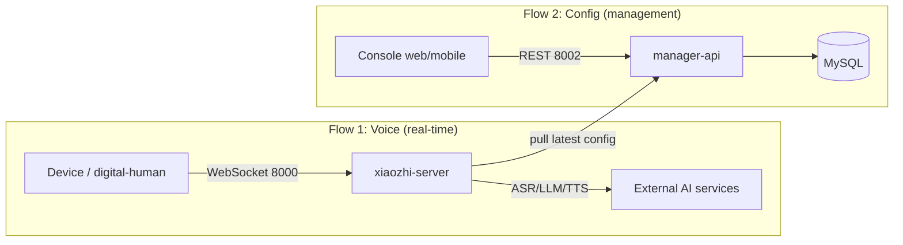

# 01 · System Overview & the Two Planes

## 1. Components and ports

| Component | What it is | Tech | Port | Plane |
|-----------|------------|------|------|-------|
| ESP32 hardware | Real device (mic / speaker / buttons) | C++ firmware | client | real-time |
| `digital-human` | Browser-based ESP32 simulator + local wake word | Python + JS | 8006 (local) | real-time (simulated) |
| `xiaozhi-server` | Voice AI engine | Python 3 + asyncio | **8000** WS / **8003** simple OTA | real-time |
| `manager-api` | Admin backend (config single source of truth) | Java 21 + Spring Boot 3 | **8002** | control |
| `manager-web` | Web admin UI | Vue.js 2 | 8001 (via Nginx) | control |
| `manager-mobile` | Mobile admin app | uni-app + Vue3 | none fixed | control |
| MySQL / Redis | Persistence / cache | - | internal | control |

> Note: in the full-stack deployment, `manager-api` and `manager-web` ship together in the same
> `web_latest` image (Java + Nginx), so only port 8002 is exposed externally.

## 2. The two main flows (remember just these two)



- **Flow 1 (real-time)**: user speaks → device pushes audio to the engine over WebSocket →
  engine runs VAD→ASR→LLM→TTS → pushes synthesized voice back for playback.
  **This flow needs low latency — it is `xiaozhi-server`'s core mission.**
- **Flow 2 (config)**: admin changes AI vendors, agent personas, devices, keys in the console →
  stored in manager-api's MySQL → `xiaozhi-server` **pulls** the latest config at startup or on update.
  **This flow is not latency-critical — it is `manager-api`'s core mission.**

## 3. Three-layer mental model

```
┌─────────────────────────────────────────────────┐
│ Device layer   ESP32 / digital-human (simulator) │  ← what you "see" as hardware
├─────────────────────────────────────────────────┤
│ Engine layer   xiaozhi-server (one operator per  │  ← the code you'll modify most
│                device)                           │
├─────────────────────────────────────────────────┤
│ Management     manager-api + web/mobile +        │  ← config & accounts & device records
│ layer          MySQL/Redis                       │
└─────────────────────────────────────────────────┘
```

- The device layer only knows the engine's WebSocket (8000) and OTA (8002 in full-stack, 8003 standalone).
- The engine layer knows the management layer above (pulls config) and the devices + external AI below.
- The management layer never talks to devices and never touches audio.

## 4. Where digital-human sits

It's half in the device layer (the browser plays the ESP32 role over the same protocol) and half
self-contained (the local wake-word runtime on port 8006). See the
[digital-human README](../digital-human/README.md) for details.
Remember: **it is an "ESP32 without hardware"** — the best tool for debugging the engine layer.

## 5. Key takeaways (important for customization)

- Want to change **voice behavior** (persona, features, AI vendors) → modify the engine layer (`xiaozhi-server`).
- Want to change **admin UI / permissions / device records** → modify the management layer (`manager-api` + web/mobile).
- Want to **swap AI vendors without writing code** → configure in the console (the engine supports hot reload).
- Want to **add a brand-new capability** → prefer an engine-layer plugin / Provider (lowest cost).
