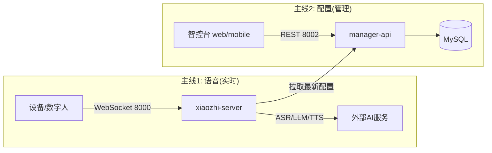

# 01 · 系统总览与两大平面

## 1. 组件与端口

| 组件 | 是什么 | 技术 | 端口 | 归属平面 |
|------|--------|------|------|----------|
| ESP32 硬件 | 真实设备(麦克风/喇叭/按钮) | C++ 固件 | 客户端 | 实时 |
| `digital-human` | 浏览器模拟 ESP32 + 本地唤醒词 | Python + JS | 8006(本地) | 实时(模拟) |
| `log-viewer` | 独立实时日志面板(排障工具) | Python + HTML/JS | 8007(本地) | 开发/运维 |
| `xiaozhi-server` | 语音 AI 引擎 | Python 3 + asyncio | **8000** WS / **8003** 简单OTA | 实时 |
| `manager-api` | 管理后端(配置唯一真源) | Java 21 + Spring Boot 3 | **8002** | 控制 |
| `manager-web` | Web 管理界面 | Vue.js 2 | 8001(经 Nginx) | 控制 |
| `manager-mobile` | 移动管理端 | uni-app + Vue3 | 无固定 | 控制 |
| MySQL / Redis | 持久化 / 缓存 | - | 内部 | 控制 |

> 注意:全栈部署时 `manager-api` 与 `manager-web` 常打包在同一个 `web_latest` 镜像里(Java + Nginx),所以对外只有 8002 一个口。

## 2. 两条主线(记住这两条就够了)



- **主线1(实时)**:用户说话 → 设备把音频经 WebSocket 推给引擎 → 引擎完成
  VAD→ASR→LLM→TTS → 把语音推回设备播放。**这条线要求低延迟,是 xiaozhi-server 的核心使命。**
- **主线2(配置)**:管理员在智控台改 AI 供应商、Agent 人设、设备、密钥 → 存进
  manager-api 的 MySQL → `xiaozhi-server` 启动或收到更新指令时主动来"拉取"最新配置。
  **这条线不要求实时,是 manager-api 的核心使命。**

## 3. 三层心智模型

```
┌─────────────────────────────────────────────────┐
│ 设备层    ESP32 / digital-human(模拟器)          │  ← 你看到的"硬件"
├─────────────────────────────────────────────────┤
│ 引擎层    xiaozhi-server(一个设备一个接线员)      │  ← 你改得最多的代码
├─────────────────────────────────────────────────┤
│ 管理层    manager-api + web/mobile + MySQL/Redis │  ← 配置 & 账号 & 设备档案
└─────────────────────────────────────────────────┘
```

- 设备层**向上**只认识引擎的 WebSocket(8000)和 OTA(全栈下 8002,单机下 8003)。
- 引擎层**向上**认识管理层(拉配置),**向下**认识设备(WS)与外部 AI 服务。
- 管理层**不直接**接触设备,也不碰语音。

## 4. digital-human 的特殊位置

它一半在设备层(浏览器扮演 ESP32,走同一套协议),一半自包含(本地 8006 的
唤醒词运行时)。详细见 [digital-human README](../digital-human/README.md)。
记住:**它就是"没有硬件的 ESP32"**,是调试引擎层的最佳工具。

## 5. 关键推论(对定制很重要)

- 想改**语音行为**(人设、功能、AI 供应商)→ 改引擎层(`xiaozhi-server`)。
- 想改**管理界面/权限/设备档案** → 改管理层(`manager-api` + web/mobile)。
- 想**不写代码**就换 AI 供应商 → 智控台配置即可(引擎层支持热加载)。
- 想**加全新能力** → 优先在引擎层加插件/Provider(成本最低)。
