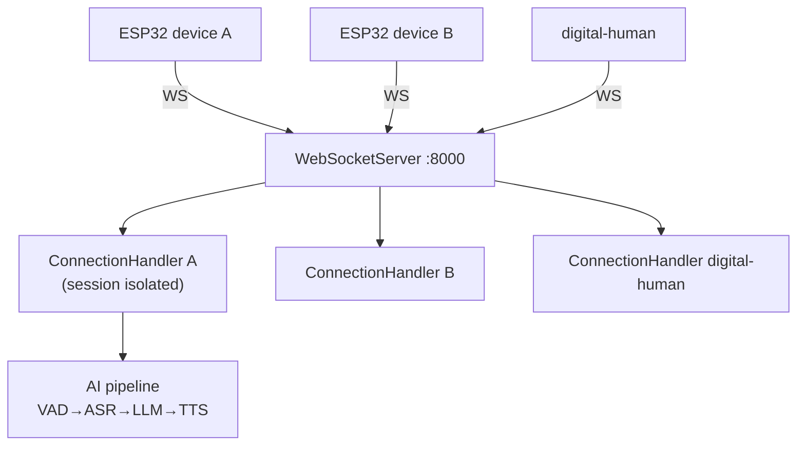
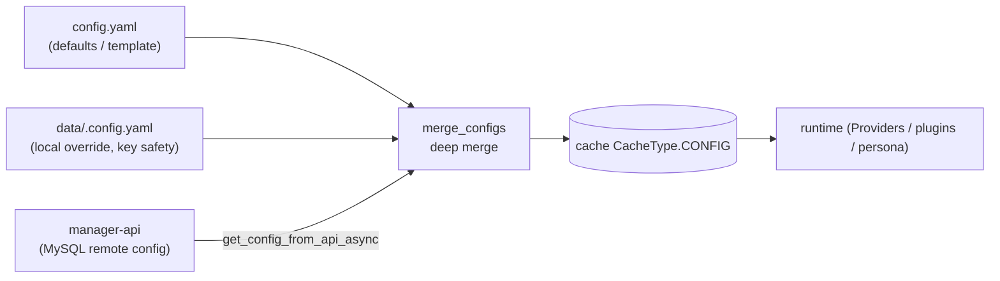
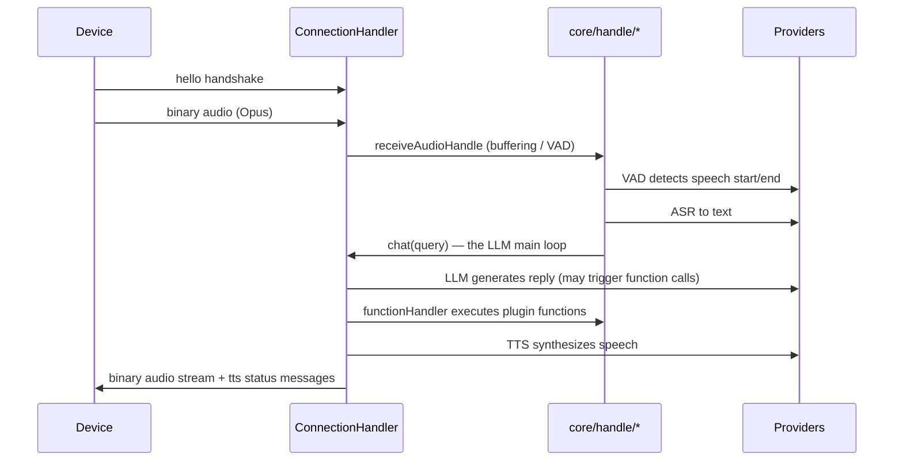

# 02 · xiaozhi-server Core Engine (the most important part to customize)

> Code location: `main/xiaozhi-server/`. ~80% of your customization work happens here.

## 1. Mental model: one "operator" per device



- **Entry point**: `app.py` starts two servers — `WebSocketServer` (:8000, the voice channel) and
  `SimpleHttpServer` (:8003, standalone OTA / vision analysis).
- **Each connection** = one `ConnectionHandler` instance in `core/connection.py`. It owns that
  device's session context, config, audio buffers, and dialogue state — fully isolated from other devices.
- Incoming messages are dispatched by `_route_message()` to small modules under `core/handle/`.

## 2. Config layering (understand this first; everything else follows)



Rules (from `config/config_loader.py`):
1. **Defaults** live in `config.yaml` (1046 lines, includes every Provider example + inline docs).
2. **Local overrides** go in `data/.config.yaml` (gitignored to protect keys) — only write the keys you change.
3. **Remote override**: if `manager-api.url` is configured, the engine fetches console config and
   overlays it on the same key names.
4. The merged result is **cached** and supports **hot reload** (`WebSocketServer.update_config()`
   → `initialize_modules()`).

> Takeaway: to quickly try a new Provider locally, only edit `data/.config.yaml` — don't touch `config.yaml`.

## 3. The Provider pattern: AI capabilities = pluggable vendors

This is the **soul of the engine**. Each AI capability has a directory under `core/providers/`:

```
core/providers/
├── asr/     # speech recognition   base.py defines the abstract interface
├── tts/     # speech synthesis
├── llm/     # large language model
├── vllm/    # vision-language model
├── vad/     # voice activity detection
├── intent/  # intent recognition
├── memory/  # memory
└── tools/   # MCP tools
```

**The pattern**: each directory has a `base.py` (abstract base class defining the interface) plus
concrete implementations. E.g. ASR has `fun_local.py` (local FunASR), `aliyun.py`, `doubao.py`,
`openai.py`, etc. — all inherit `ASRProviderBase` and implement `async def speech_to_text(...)`.

**Swapping vendors = editing config**:

```yaml
selected_module:
  ASR: FunASR        # ← change to DoubaoASR / OpenaiASR ... and you're done
  LLM: ChatGLMLLM
  TTS: EdgeTTS
  VAD: SileroVAD
  Intent: function_call
  Memory: nomem
```

**Factory**: `core/utils/modules_initialize.py` reads `selected_module` at startup and
dynamically imports + instantiates the matching classes. So **adding a vendor = write a class that
inherits base + add a config block; the core pipeline stays untouched.**

## 4. The voice pipeline (how audio becomes a spoken reply)



`handle` module responsibilities (`core/handle/`):

| Module | Responsibility |
|--------|----------------|
| `helloHandle.py` | Handshake, device auth, initialization |
| `receiveAudioHandle.py` | Receive audio, feed VAD, trigger ASR |
| `textHandle.py` / `textMessageHandler*` | Text message routing |
| `intentHandler.py` | Intent recognition (exit / music / volume etc.) |
| `functionHandler.py` | Execute plugin functions requested by the LLM |
| `sendAudioHandle.py` | TTS audio delivery |
| `abortHandle.py` | Interruption (wake-word barge-in, stop playback) |
| `reportHandle.py` | Device status reporting |

## 5. Plugin system: give the assistant "skills"

Location: `plugins_func/`. Adding a skill takes three steps (template: `get_weather.py`):

```python
from plugins_func.register import register_function, ToolType, Action, ActionResponse

# 1. Write an LLM-readable function description (JSON Schema)
MY_FUNC_DESC = {"type": "function", "function": {
    "name": "my_tool",
    "description": "what this tool does...",
    "parameters": {"type": "object", "properties": {...}, "required": [...]},
}}

# 2. Register with the decorator
@register_function("my_tool", MY_FUNC_DESC, ToolType.SYSTEM_CTL)
async def my_tool(conn, arg1=None):
    ...
    return ActionResponse(Action.REQLLM, result_text, None)
```

Core concepts (`plugins_func/register.py`):
- **`register_function(name, desc, type)`**: registers the function + its LLM description + type into
  a global registry. Once registered, **the LLM automatically "sees" the tool** (the description is
  injected into the system prompt) and can issue a "function call" when needed.
- **`ToolType`**: categorizes the function — `NONE` (no side effects), `WAIT` (wait for result),
  `CHANGE_SYS_PROMPT` (switch persona), `SYSTEM_CTL` (control the dialogue flow, e.g. exit/music),
  `IOT_CTL` (IoT control).
- **`Action`**: decides how the return value is used — `REQLLM` (feed result back to the LLM to
  phrase the reply), `RESPONSE` (reply directly), `RECORD` (log to history without calling the LLM).
- **Load-on-demand**: the `Intent.function_call.functions` list in `config.yaml` decides which plugins
  are loaded (unlisted plugins aren't registered, so the LLM never sees them).

## 6. Where the persona (prompt) lives

- The `prompt:` block at the top of `config.yaml` is the default persona (the 台湾腔 "小智" persona).
- `prompt_template: agent-base-prompt.txt` is the system-prompt template (tool descriptions,
  closing remarks, etc. get injected).
- The 智控台 or the `change_role` plugin can switch personas at runtime.

## 7. Quick file reference (start here when modifying code)

| What you want to change | File |
|-------------------------|------|
| Startup flow / ports / FFmpeg check | `app.py` |
| Add / swap AI vendors | `core/providers/<type>/` + config |
| Change the dialogue pipeline | `core/handle/`, `core/connection.py::chat()` |
| Add a feature / skill | `plugins_func/functions/` + config load list |
| Change defaults / persona | `config.yaml` |
| Local override (not committed) | `data/.config.yaml` |
| Config loading / merging / remote pull | `config/config_loader.py` |
| Device communication protocol | `core/websocket_server.py`, `core/connection.py` |
