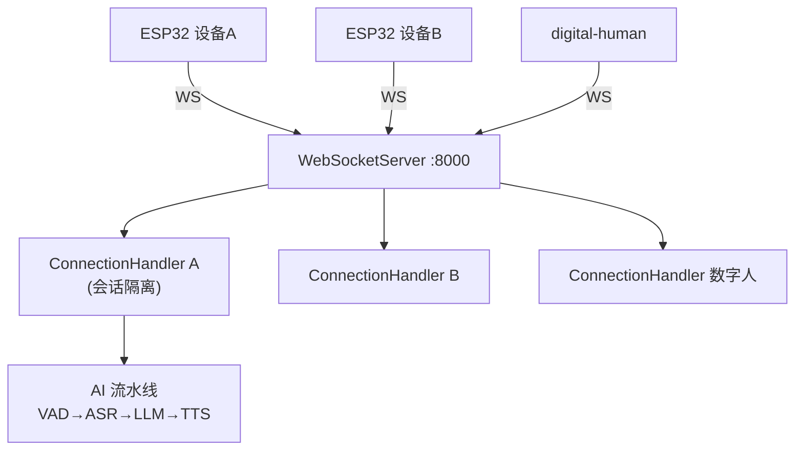
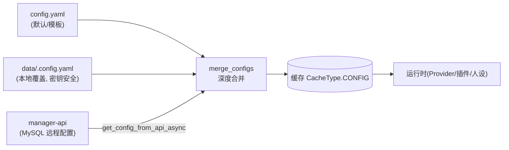
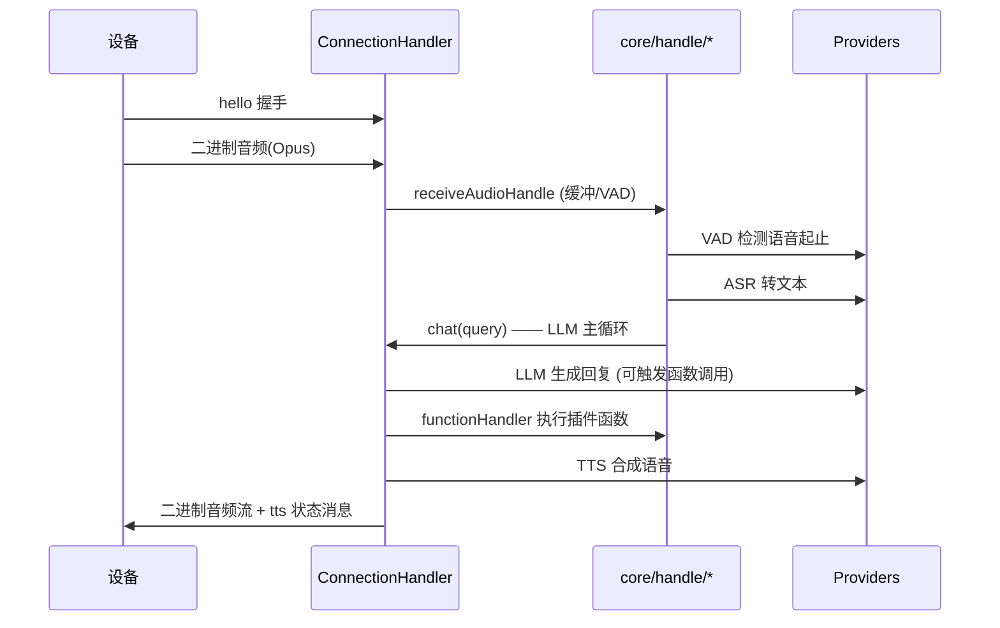

# 02 · xiaozhi-server 核心引擎(定制的重中之重)

> 代码位置:`main/xiaozhi-server/`。这是你 80% 定制工作发生的地方。

## 1. 心智模型:每个设备一个"接线员"



- **入口**:`app.py` 启动两个服务 —— `WebSocketServer`(:8000,语音主通道)和
  `SimpleHttpServer`(:8003,单机 OTA/视觉分析)。
- **每个连接** = 一个 `core/connection.py::ConnectionHandler` 实例。它持有该设备的
  会话上下文、配置、音频缓冲、对话状态 —— 设备间完全隔离。
- 消息进来后 `_route_message()` 按类型分发给 `core/handle/` 下的小模块。

## 2. 配置分层(先搞懂这个,后面都好说)



规则(来自 `config/config_loader.py`):
1. **默认值**在 `config.yaml`(1046 行,自带全部 Provider 示例和说明)。
2. **本地覆盖**放 `data/.config.yaml`(`.gitignore` 忽略,保护密钥)—— 只写要改的键。
3. **远程覆盖**:若配置了 `manager-api.url`,会去拉取智控台里的配置并覆盖同名字段。
4. 合并结果**缓存**并支持**热加载**(`WebSocketServer.update_config()` → `initialize_modules()`)。

> 推论:你想在本地快速试一个新 Provider,只改 `data/.config.yaml` 即可,不动 `config.yaml`。

## 3. Provider 模式:AI 能力 = 插拔式供应商

这是整个引擎的**灵魂设计**。每种 AI 能力在 `core/providers/` 下有一个目录:

```
core/providers/
├── asr/     # 语音识别   base.py 定义抽象接口
├── tts/     # 语音合成
├── llm/     # 大语言模型
├── vllm/    # 视觉语言模型
├── vad/     # 语音活动检测
├── intent/  # 意图识别
├── memory/  # 记忆
└── tools/   # MCP 工具
```

**模式**:每个目录里一个 `base.py`(抽象基类 ABC,定义接口),外加一堆具体实现类。
例如 ASR 有 `fun_local.py`(本地 FunASR)、`aliyun.py`、`doubao.py`、`openai.py` 等,
全部继承 `ASRProviderBase` 并实现 `async def speech_to_text(...)`。

**换供应商 = 改配置**:

```yaml
selected_module:
  ASR: FunASR        # ← 改成 DoubaoASR / OpenaiASR ... 即可
  LLM: ChatGLMLLM
  TTS: EdgeTTS
  VAD: SileroVAD
  Intent: function_call
  Memory: nomem
```

**工厂**:`core/utils/modules_initialize.py` 启动时读 `selected_module`,
动态导入并实例化对应的类。所以**加一个新供应商 = 写一个继承 base 的类 + 在配置里加一段**,
核心流水线一行不用改。

## 4. 语音流水线(一条音频是怎么变成语音回复的)



各 `handle` 模块职责(`core/handle/`):

| 模块 | 职责 |
|------|------|
| `helloHandle.py` | 握手、设备认证、初始化 |
| `receiveAudioHandle.py` | 收音频、喂 VAD、触发 ASR |
| `textHandle.py` / `textMessageHandler*` | 文本消息路由 |
| `intentHandler.py` | 意图识别(退出/音乐/音量等) |
| `functionHandler.py` | 执行 LLM 请求的插件函数 |
| `sendAudioHandle.py` | TTS 音频下发 |
| `abortHandle.py` | 打断(唤醒词打断、停止播报) |
| `reportHandle.py` | 设备状态上报 |

## 5. 插件系统:给助手"加技能"

位置:`plugins_func/`。加一个功能只需三步(以 `get_weather.py` 为模板):

```python
from plugins_func.register import register_function, ToolType, Action, ActionResponse

# 1. 写 LLM 能看懂的函数描述(JSON Schema)
MY_FUNC_DESC = {"type": "function", "function": {
    "name": "my_tool",
    "description": "这个工具做什么...",
    "parameters": {"type": "object", "properties": {...}, "required": [...]},
}}

# 2. 用装饰器注册
@register_function("my_tool", MY_FUNC_DESC, ToolType.SYSTEM_CTL)
async def my_tool(conn, arg1=None):
    ...
    return ActionResponse(Action.REQLLM, result_text, None)
```

核心概念(`plugins_func/register.py`):
- **`register_function(name, desc, type)`**:把函数 + LLM 描述 + 类型注册进全局注册表。
  注册后 **LLM 会自动看到这个工具**(描述被拼进 system prompt),需要时发起"函数调用"。
- **`ToolType`**:决定函数类别 —— `NONE`(无副作用)、`WAIT`(等结果)、
  `CHANGE_SYS_PROMPT`(切换人设)、`SYSTEM_CTL`(控制对话流程,如退出/音乐)、
  `IOT_CTL`(物联网控制)。
- **`Action`**:决定返回值怎么用 —— `REQLLM`(结果回给 LLM 生成回复)、
  `RESPONSE`(直接回复)、`RECORD`(只记历史不调 LLM)。
- **按需加载**:`config.yaml` 的 `Intent.function_call.functions` 列表决定加载哪些插件
  (没列出就不会被注册,LLM 也看不到)。

## 6. 人设(Prompt)在哪里

- `config.yaml` 顶部的 `prompt:` 就是默认人设(小智的台湾腔人设)。
- `prompt_template: agent-base-prompt.txt` 是系统提示词模板(工具描述、结束语等会被注入)。
- 用智控台/`change_role` 插件可在运行中切换角色人设。

## 7. 关键文件速查(改代码时从这里下手)

| 想改什么 | 文件 |
|----------|------|
| 启动流程 / 端口 / FFmpeg 检查 | `app.py` |
| 加/换 AI 供应商 | `core/providers/<类型>/` + 配置 |
| 改对话流水线 | `core/handle/`, `core/connection.py::chat()` |
| 加功能/技能 | `plugins_func/functions/` + 配置加载列表 |
| 改默认配置/人设 | `config.yaml` |
| 本地覆盖(不提交) | `data/.config.yaml` |
| 配置加载/合并/拉取远程 | `config/config_loader.py` |
| 设备通信协议实现 | `core/websocket_server.py`, `core/connection.py` |
