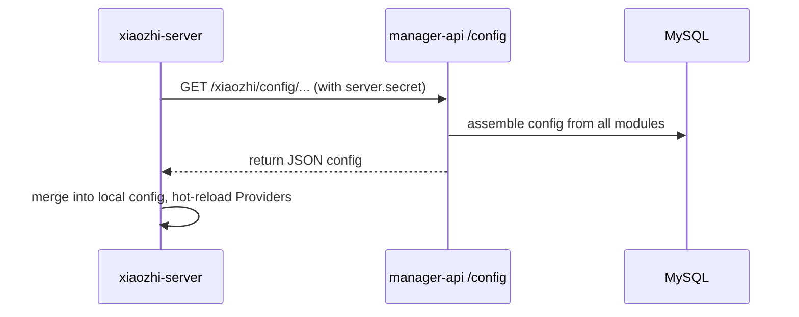

# 03 · manager-api Admin Backend

> Code location: `main/manager-api/` (Java 21 + Spring Boot 3 + MyBatis-Plus + MySQL + Redis + Shiro).
> Mental model: **it is the single source of truth for configuration — but it never touches voice.**

## 1. What it manages (in one sentence)

**It moves "how the system should run" out of code and into the database.**
Whatever the engine needs to know, it gets from here; whatever the admin changes, is changed here.

## 2. Business module map

Under `src/main/java/xiaozhi/modules/`, modules are split by business domain:

```mermaid
flowchart TB
    API["manager-api :8002/xiaozhi"]
    API --> SYS["sys · users / roles / params / dicts / menus"]
    API --> AGENT["agent · agents (personas / roles)"]
    API --> DEVICE["device · device registration / binding / OTA"]
    API --> MODEL["model · AI model config<br/>(ASR/LLM/TTS vendors & keys)"]
    API --> CFG["config · provides config to xiaozhi-server"]
    API --> TIMBRE["timbre · TTS voice management"]
    API --> KB["knowledge · knowledge base (RAG)"]
    API --> VC["voiceclone · voice cloning"]
    API --> SEC["security · login / auth / captcha"]
    API --> SMS["sms · SMS verification"]
    API --> CW["correctword · ASR correction words"]
```



Each module follows the standard three layers:
**Controller (REST) → Service (business) → DAO (MyBatis-Plus)**, plus Entity/DTO.

## 3. Key data model (the important tables)

| Concept | Notes |
|---------|-------|
| sys_user | Users; the first registered user is the super admin |
| sys_params | **Params table** — global key-values like `server.secret` live here |
| device | Device records (registered by MAC, bound to an agent's owner) |
| agent | An agent = a persona + bound model config + devices |
| model_config | AI vendor instance (provider + api_key + model_name) |
| timbre | Voices |

## 4. How the engine gets config from it



- Auth relies on `server.secret` (auto-generated on first deploy, stored in `sys_params`).
- The engine pulls at startup or on update; when a device connects it also pulls that
  **device's private config** (`get_private_config_from_api(device_id, client_id)`).

## 5. Security mechanisms (why bootstrap was such a hassle)

| Mechanism | Purpose |
|-----------|---------|
| Apache Shiro | Login state / permission checks (stateless REST token) |
| SM2 (Chinese national crypto) | Passwords are encrypted in transit (frontend encrypts with public key, backend decrypts) |
| Image captcha | Anti-bot; plaintext briefly stored in Redis (`sys:captcha:<uuid>`) |
| `server.secret` | Shared secret between engine ↔ manager-api (our bootstrap script automates this) |
| Liquibase | Version-controlled DB schema; auto-migration at startup |

> This is exactly why `bootstrap-admin.py` exists: SM2 + captcha means "register the first admin"
> can't be done with a simple curl — it requires the full encrypted flow.

## 6. OTA flow (managed by manager-api in full-stack mode)

```
Device POST /xiaozhi/ota/  →  manager-api validates / registers the device
                          →  returns websocket url + token
Device connects WS (8000)  →  engine takes over the voice session
```

In standalone mode (no manager-api), this OTA endpoint is served by xiaozhi-server on :8003.

## 7. Customization entry points

| What you want to change | Where |
|-------------------------|-------|
| Add a new REST business API | Add a Controller under `modules/<module>/controller/` |
| Change auth / permissions | `modules/security/`, `common/config/ShiroConfig.java` |
| Change params / config items | `sys_params` table + `modules/sys/` |
| Add a device type / device tool | `modules/device/` + engine-side IOT_CTL plugin |
| Add / alter DB tables | Liquibase changelog + matching Entity/Mapper |
| API docs | after startup: `http://<host>:8002/xiaozhi/doc.html` (Knife4j) |
