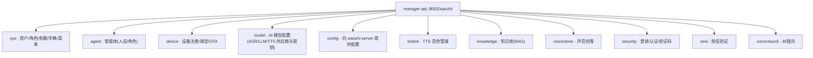
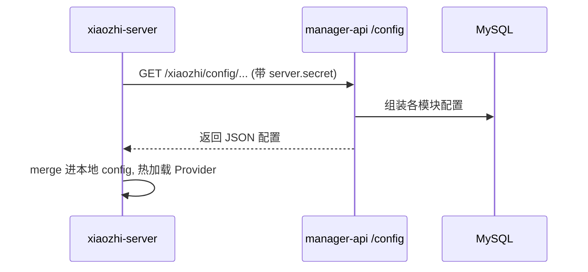

# 03 · manager-api 管理后端

> 代码位置:`main/manager-api/`(Java 21 + Spring Boot 3 + MyBatis-Plus + MySQL + Redis + Shiro)。
> 心智模型:**它是整个系统的"配置唯一真源",但它不碰语音。**

## 1. 它管什么(一句话)

**把"系统该怎么运行"这件事,从代码里搬到数据库里。**
引擎需要什么配置,从它这里拿;管理员改什么,也改到它这里。

## 2. 业务模块地图

`src/main/java/xiaozhi/modules/` 下按业务领域分模块:



每个模块内部都是标准三层:**Controller(REST) → Service(业务) → DAO(MyBatis-Plus)**,外加 Entity/DTO。

## 3. 数据模型(几张关键表)

| 概念 | 说明 |
|------|------|
| sys_user | 用户;第一个注册的是超级管理员 |
| sys_params | **参数表**,`server.secret` 等全局键值都在这 |
| device | 设备档案(按 MAC 注册、绑定到某个 agent 的用户) |
| agent | 智能体 = 一套人设 + 绑定的模型配置 + 设备 |
| model_config | AI 供应商实例(provider + api_key + model_name) |
| timbre | 音色 |

## 4. 引擎怎么从它拿配置



- 鉴权靠 `server.secret`(首次部署自动生成,存在 `sys_params`)。
- 引擎启动或收到更新指令时拉取;设备连上时还会拉**该设备的私有配置**
  (`get_private_config_from_api(device_id, client_id)`)。

## 5. 安全机制(为什么引导这么麻烦)

| 机制 | 作用 |
|------|------|
| Apache Shiro | 登录态/权限校验(REST 无状态 token) |
| SM2 国密加密 | 密码在传输中加密(前端用公钥加密,后端私钥解密) |
| 图形验证码 | 防机器人,明文暂存 Redis(`sys:captcha:<uuid>`) |
| `server.secret` | 引擎 ↔ manager-api 之间的共享密钥(我们 bootstrap 脚本就是自动完成这套) |
| Liquibase | 数据库结构变更版本化,启动自动迁移 |

> 这正是当初 `bootstrap-admin.py` 存在的意义:SM2 + 验证码让"注册第一个管理员"
> 没法用简单 curl 完成,必须走加密流程。

## 6. OTA 流程(全栈模式下归它管)

```
设备 POST /xiaozhi/ota/  →  manager-api 校验/注册设备
                          →  返回 websocket url + token
设备连 WS(8000) 认证     →  引擎接管语音
```

单机(无 manager-api)时,这个 OTA 端点由 xiaozhi-server 的 :8003 提供。

## 7. 定制入口速查

| 想改什么 | 位置 |
|----------|------|
| 新增一个 REST 业务接口 | `modules/<模块>/controller/` 加 Controller |
| 改认证/权限 | `modules/security/`, `common/config/ShiroConfig.java` |
| 改参数/配置项 | `sys_params` 表 + `modules/sys/` |
| 加一个设备类型/设备工具 | `modules/device/` + 引擎侧 IOT_CTL 插件 |
| 数据库加表/改表 | Liquibase changelog + 对应 Entity/Mapper |
| API 文档 | 启动后访问 `http://<host>:8002/xiaozhi/doc.html`(Knife4j) |
