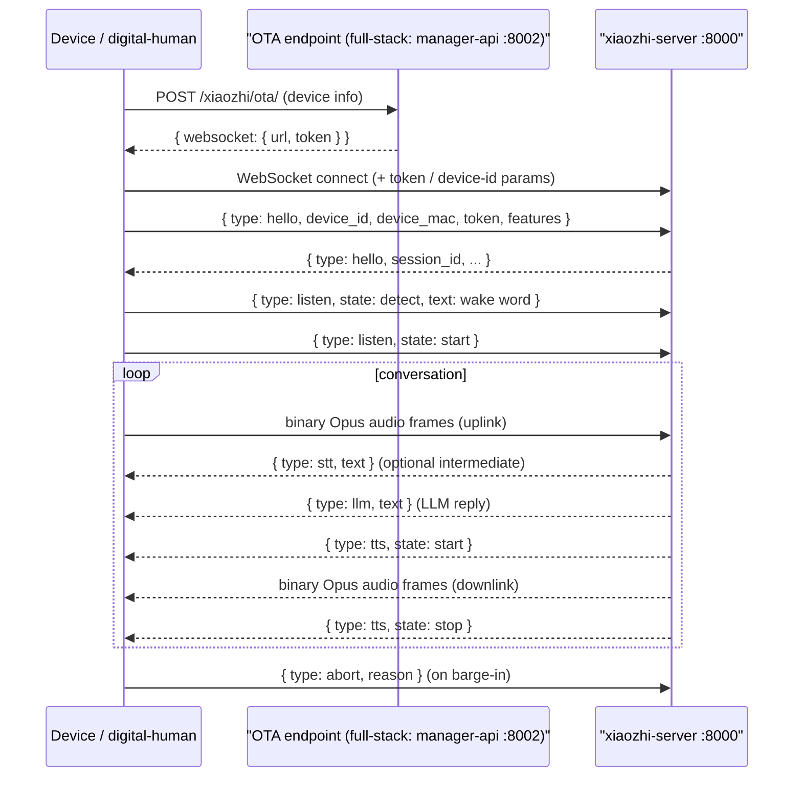

# 04 · Device Protocol (the "language" between device and engine)

> Devices (ESP32 or digital-human) talk to `xiaozhi-server` over **WebSocket**.
> Two kinds of messages: **text messages (JSON control)** and **binary messages (Opus audio)**.
> Reference implementation: `main/digital-human/js/core/network/websocket.js` (the easiest client to read).

## 1. Message types (`core/handle/textMessageType.py`)

| type | direction | purpose |
|------|-----------|---------|
| `hello` | device → server | handshake; carries device_id / mac / token / features |
| `listen` | device → server | listening state (`detect` / `start` / `stop`); may carry wake-word text |
| `abort` | both | interrupt current playback / dialogue |
| `iot` | both | IoT device control commands |
| `mcp` | both | MCP protocol (tool list / call) |
| `server` | server → device | server commands (e.g. reconnect) |
| `ping` | both | keep-alive heartbeat |
| `stt` | server → device | speech recognition intermediate result |
| `llm` | server → device | LLM reply text |
| `tts` | server → device | synthesis state (`start` / `sentence_start` / `sentence_end` / `stop`) |

## 2. Full session sequence

## 3. Handshake details (from the digital-human code)

- **OTA request**: POST to the OTA URL with `Device-Id` / `Client-Id` headers and a device-description
  JSON (firmware version, MAC, board type, ...). The response contains `websocket.url` and `token`.
- **WS connect**: the token goes in as an `authorization` query parameter, plus `device-id` / `client-id`.
- **hello message**: `features` declares capabilities like `mcp`, `emoji`. The server returns a
  `session_id`; every later message carries it.

## 4. MCP sub-protocol (the device is an MCP client)

The server (MCP server) may ask the device to:
- `initialize`: handshake, may carry vision-capability config (url / token)
- `tools/list`: ask the device what tools it can provide
- `tools/call`: ask the device to execute a tool (e.g. open camera, remote wake-up)

Replies follow JSON-RPC 2.0 structure (`jsonrpc` / `id` / `result` / `error`).
This is the "device capability" mechanism — whatever MCP tools are compiled into the ESP32 firmware
is what it can report.

## 5. Audio format

- Codec: **Opus**. Server config lives in `config.yaml` under `xiaozhi.audio_params`
  (sample_rate 24000, channels 1, frame_duration 60ms, etc.).
- Uplink: device mic → Opus frames → WS binary messages.
- Downlink: server TTS → Opus frames → WS binary messages.

## 6. Why this matters for customization

- **Add a new device command** → add a handler under `core/handle/` and a type in `textMessageType.py`.
- **Simulate / test a device** → read digital-human's `websocket.js`; it's a complete reference client.
- **Give the device new capabilities (camera / buttons)** → use the MCP tool mechanism:
  implement on the device side + wire up in the engine's `core/providers/tools/`.
