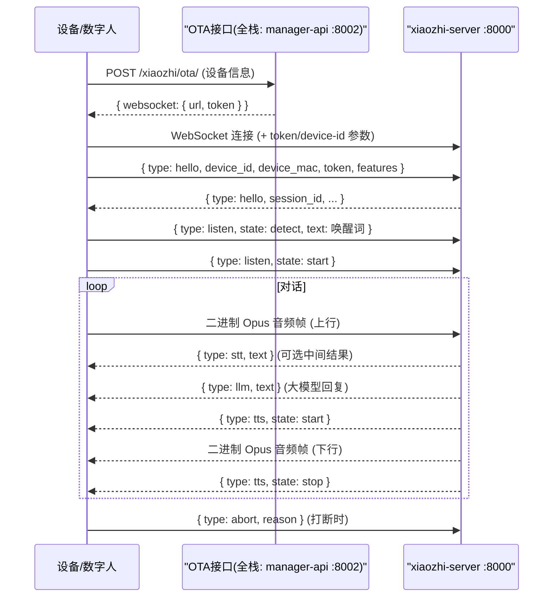

# 04 · 设备协议(设备 ↔ 引擎的"语言")

> 设备(ESP32 或 digital-human)与 `xiaozhi-server` 之间通过 **WebSocket** 通信。
> 消息分两类:**文本消息(JSON 控制)** 和 **二进制消息(Opus 音频)**。
> 实现参考:`main/digital-human/js/core/network/websocket.js`(最易读的参考客户端)。

## 1. 消息类型(`core/handle/textMessageType.py`)

| type | 方向 | 用途 |
|------|------|------|
| `hello` | 设备→服务器 | 握手,带 device_id/mac/token/features |
| `listen` | 设备→服务器 | 监听状态(`detect`/`start`/`stop`),可带唤醒词文本 |
| `abort` | 双向 | 打断当前播报/对话 |
| `iot` | 双向 | IoT 设备控制指令 |
| `mcp` | 双向 | MCP 协议(工具列表/调用) |
| `server` | 服务器→设备 | 服务器命令(如重连) |
| `ping` | 双向 | 心跳保活 |
| `stt` | 服务器→设备 | 语音识别中间结果 |
| `llm` | 服务器→设备 | 大模型回复文本 |
| `tts` | 服务器→设备 | 语音合成状态(`start`/`sentence_start`/`sentence_end`/`stop`) |

## 2. 完整会话时序

## 3. 握手细节(来自 digital-human 代码)

- **OTA 请求**:POST 到 OTA 地址,携带 `Device-Id` / `Client-Id` header 和
  设备描述 JSON(固件版本、MAC、板型等)。返回里带 `websocket.url` 和 `token`。
- **WS 连接**:把 token 作为 `authorization` 查询参数,把 `device-id`、`client-id`
  也带上。
- **hello 消息**:`features` 里声明 `mcp`、`emoji` 等能力。服务器返回 `session_id`,
  之后所有消息都带它。

## 4. MCP 子协议(设备是 MCP 客户端)

服务器(MCP server)可向设备发起:
- `initialize`:初始化,带视觉分析能力配置(url/token)
- `tools/list`:让设备上报自己能提供的工具
- `tools/call`:让设备执行某个工具(如打开摄像头、远程唤醒)

设备回复遵循 JSON-RPC 2.0 结构(`jsonrpc` / `id` / `result` / `error`)。
这就是"设备能力"的机制 —— ESP32 固件编译进了什么 MCP 工具,就能上报什么。

## 5. 音频格式

- 编码:**Opus**,服务器配置在 `config.yaml` 的 `xiaozhi.audio_params`
  (sample_rate 24000、channels 1、frame_duration 60ms 等)。
- 上行:设备麦克风 → Opus 帧 → WS 二进制消息。
- 下行:服务器 TTS → Opus 帧 → WS 二进制消息。

## 6. 为什么这对定制重要

- **想加新的设备指令** → 在 `core/handle/` 加一个 handler,在 `textMessageType.py` 加类型。
- **想模拟/测试设备** → 直接看 digital-human 的 `websocket.js`,它就是完整参考实现。
- **想给设备加能力(如摄像头/按键)** → 通过 MCP 工具机制,设备侧实现 + 引擎侧
  `core/providers/tools/` 对接。
