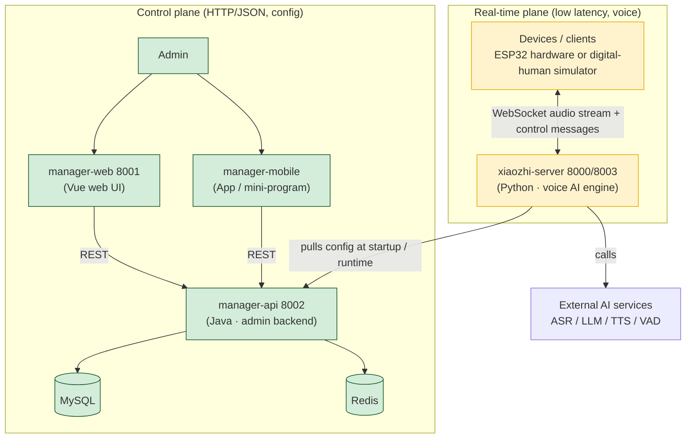

# 🧠 Mental Model: xiaozhi-esp32-server (Full System)

> Goal: build a complete map of the system in your head *before* you start customizing.
> These docs are grounded in **actual code** (not just the README); every path is a real jump-off point.
> The numbering is the recommended reading order.

| Doc | Contents |
|-----|----------|
| [01 System Overview & Two Planes](01-system-overview.en.md) | Components, ports, and the two main flows |
| [02 xiaozhi-server Core Engine](02-xiaozhi-server.en.md) | ⭐ Most important: config layering, Provider pattern, plugins, voice pipeline |
| [03 manager-api Backend](03-manager-api.en.md) | Single source of truth for config, modular backend, security & bootstrap |
| [04 Device Protocol](04-device-protocol.en.md) | The "language" between device and server (WebSocket messages) |
| [05 Customization Guide](05-customization-guide.en.md) | "I want to change X" → go to file Y |

> Chinese versions are the sibling `.md` files (e.g. `01-system-overview.md`).

---

## The whole system in one picture: two planes

> **This is a voice-conversation server that can listen and speak, plus an admin backend that manages its configuration.**
> Voice lives in the **real-time plane** (device ↔ engine, WebSocket); config lives in the **control plane** (admin ↔ backend, HTTP).

## Five mental anchors to remember

1. **`xiaozhi-server` = one "operator" per device**
   When a device connects, the server spawns a dedicated `ConnectionHandler` (an operator)
   that manages that device's whole "listen → think → speak" session. Devices never interfere.

2. **AI capabilities = pluggable "vendors"**
   Each capability (ASR / LLM / TTS / VAD / ...) is an **abstract interface + many implementations**.
   Swapping vendors = editing config, not code. This is the easiest part of the system to extend.

3. **Feature extension = register a "function"**
   Want the assistant to check weather or control smart-home gear? Write a Python function and add
   one `@register_function` decorator. The LLM automatically "sees" the tool and calls it when needed.

4. **Config has three layers; each overrides the one below**
   `config.yaml` (default) → `data/.config.yaml` (local override) → `manager-api` (remote/DB override).
   Editing the 智控台 (management console) edits layer three; the engine hot-reloads it.

5. **manager-api = the single source of truth for configuration**
   The engine's config, devices, users, and agent personas all live in manager-api's MySQL.
   It never touches real-time voice, but it decides *how the engine speaks, which AI it uses, and who it serves*.

## Other exploration docs

- [Component relationships](../docs/component-relationships.md)
- [Digital human → ESP32 migration](../docs/digital-human-to-esp32-migration.md)
- [digital-human getting-started record](../digital-human/README.md)
