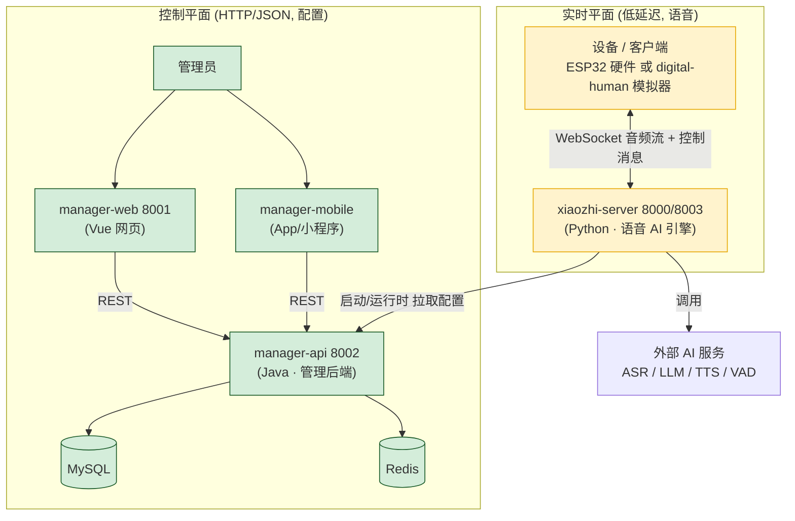

# 🧠 心智模型:xiaozhi-esp32-server 全系统

> 目标:让你在动手改代码之前,先在脑子里装下一张完整的系统地图。
> 这套文档基于**实际代码**梳理(不只是 README),所有路径可直接跳转。
> 文档序号即建议阅读顺序。

| 文档 | 内容 |
|------|------|
| [01 系统总览与两大平面](01-system-overview.md) | 组件、端口、两条主线的全局图 |
| [02 xiaozhi-server 核心引擎](02-xiaozhi-server.md) | ⭐ 最重要:配置分层、Provider 模式、插件、语音流水线 |
| [03 manager-api 管理后端](03-manager-api.md) | 配置的唯一真源、模块化后端、安全与引导 |
| [04 设备协议](04-device-protocol.md) | 设备 ↔ 服务器之间的"语言"(WebSocket 消息) |
| [05 定制指南](05-customization-guide.md) | "我想改 X" → 去改哪个文件 |

> 🌐 English versions available: `*.en.md` (e.g. [01-system-overview.en.md](01-system-overview.en.md)),
> index at [README.en.md](README.en.md)。

---

## 一图流:两大平面

整个系统可以压缩成 **一句话 + 两条主线**:

> **这是一个"能听会说"的语音对话服务器,外加一套"管配置"的管理后台。**
> 语音走**实时平面**(设备 ↔ 引擎,WebSocket),配置走**控制平面**(管理员 ↔ 后台,HTTP)。

## 五个核心心智锚点

1. **xiaozhi-server = 每个设备一个"话务员"**
   每个设备连上来,服务器就为它开一个独立的 `ConnectionHandler`(接线员),
   全程管理"听 → 想 → 说"这一个会话。设备之间互不干扰。

2. **AI 能力 = 可插拔的"供应商"**
   ASR/LLM/TTS/VAD 等每一种能力都是一个**抽象接口 + 一堆实现**。
   换供应商 = 改配置,不改代码。这是整个系统最好扩展的地方。

3. **功能扩展 = 注册一个"函数"**
   想让语音助手会查天气、控制家电?写一个 Python 函数,加一行 `@register_function` 装饰器即可。
   LLM 会自动"看到"这些函数并在需要时调用它们。

4. **配置有三层,后一层覆盖前一层**
   `config.yaml`(默认) → `data/.config.yaml`(本地覆盖) → `manager-api`(数据库远程覆盖)。
   用智控台改配置,就是改第三层,引擎会热加载。

5. **manager-api = 配置的唯一真源 (Single Source of Truth)**
   引擎的配置、设备、用户、Agent 角色,全都在 manager-api 的 MySQL 里。
   它不参与实时语音,但决定了引擎"怎么说话、用什么 AI、给谁服务"。

## 其它探索文档

- [组件关系图](../docs/component-relationships.md)
- [数字人 → ESP32 迁移](../docs/digital-human-to-esp32-migration.md)
- [digital-human 上手记录](../digital-human/README.md)
